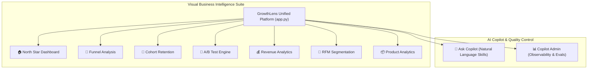
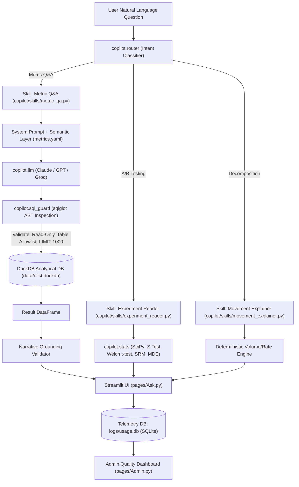

# GrowthLens: E-Commerce Analytics Suite & AI Copilot

> An end-to-end e-commerce business intelligence platform and verifiable AI analytics copilot, built with **Python 3.11+**, **Streamlit**, **DuckDB**, and **SciPy** over the Brazilian Olist e-commerce dataset (~99,441 orders).

GrowthLens brings together two complementary capabilities into a single, unified workspace:
1. **Interactive Visual Analytics Suite**: High-performance executive dashboards for North Star KPIs, funnel drop-offs, cohort retention, A/B experimentation, revenue slicing, RFM customer segmentation, and product performance.
2. **Conversational AI Analytics Copilot**: An autonomous, verifiable analytics engine that translates natural-language business questions into validated DuckDB SQL, interprets statistical experiments, decomposes metric movements, and logs every query for quality observability.

---

## ⚡ Quick Tour & Live Demo Workflow

```bash
# 1. Clone & install dependencies
pip install -r requirements.txt

# 2. Build the analytical DuckDB database (~99,441 orders)
python -m copilot.data.build

# 3. Launch the unified platform
streamlit run app.py
```

Open your browser to `http://localhost:8501`. Use the sidebar to seamlessly switch across the platform:



---

## 🌟 Core Features & Modules

### 1. Visual Business Intelligence Suite

The visual BI suite provides deep-dive, interactive exploration powered by pre-aggregated datasets and instant filtering:

- **🏠 North Star Dashboard ([`views/north_star.py`](views/north_star.py))**:
  - Executive KPI summary tracking Gross Merchandise Value (GMV), total order volume, active customer counts, and Average Order Value (AOV).
  - Trailing month-over-month (MoM) growth velocity indicators and executive health summaries.

- **🔽 Funnel Analysis ([`views/funnel.py`](views/funnel.py))**:
  - Multi-stage conversion funnel visualizing customer progression from session visits to product impressions, cart additions, checkout initiations, and completed orders.
  - Channel-level breakdown identifying friction points and drop-off rates across organic, paid search, social, and email traffic.

- **🔁 Cohort Retention ([`views/cohort.py`](views/cohort.py))**:
  - Longitudinal cohort retention matrix tracking customer re-engagement over 12+ monthly intervals.
  - Granular repeat-purchase rates, cohort size progression, and customer lifetime value (LTV) curves.

- **🧪 A/B Test Engine ([`views/ab_test.py`](views/ab_test.py))**:
  - Interactive experimentation workbench for conversion rate and continuous metric testing.
  - Frequentist significance calculation: two-proportion z-tests, Welch's t-tests, p-values, 95% confidence intervals, and automated Sample Ratio Mismatch (SRM) checks.

- **💰 Revenue Analytics ([`views/revenue.py`](views/revenue.py))**:
  - Multi-dimensional revenue analysis sliced by top product categories, Brazilian federal states (SP, RJ, MG, etc.), and installment counts.
  - Payment method distribution across credit cards, Boleto Bancário, vouchers, and debit cards.

- **👥 RFM Customer Segmentation ([`views/rfm.py`](views/rfm.py))**:
  - Algorithmic scoring of Recency, Frequency, and Monetary value for every customer.
  - Customer categorization into actionable marketing cohorts: *Champions*, *Loyal Customers*, *Potential Loyalists*, *At Risk*, and *Hibernating*.

- **📦 Product Analytics ([`views/product_analytics.py`](views/product_analytics.py))**:
  - Catalog-wide performance tracking: revenue contributions, unit volumes, and average customer review ratings.
  - Fulfillment impact analysis: correlating carrier delivery duration against customer satisfaction scores and cancellation rates.

---

### 2. Conversational AI Analytics Copilot

Alongside the visual dashboards, GrowthLens includes a conversational AI layer ([`pages/Ask.py`](pages/Ask.py)) that allows stakeholders to ask custom analytical questions in plain English without writing code or filing tickets with data teams.

#### Core Copilot Skills:
1. **Metric Q&A ([`copilot/skills/metric_qa.py`](copilot/skills/metric_qa.py))**:
   - Converts natural-language queries (e.g., *"What was our monthly GMV in 2017?"*) into clean, performant DuckDB SQL.
   - Enforces business logic defined in the canonical metrics catalog ([`metrics.yaml`](metrics.yaml)).
   - Automatically renders grounded text summaries, interactive Plotly charts, and inspectable SQL code accordions.
   - **Graceful Scope Refusal**: Explicitly detects and politely refuses questions that cannot be answered using the Olist dataset (e.g., CAC, marketing ad spend, web session bounce rates).

2. **Experiment Reader ([`copilot/skills/experiment_reader.py`](copilot/skills/experiment_reader.py))**:
   - Interprets A/B test results from user-provided sample sizes and conversions or means.
   - Evaluates statistical significance, effect size, confidence intervals, and minimum detectable effect (MDE) using SciPy, while checking for Sample Ratio Mismatch (SRM).
   - Generates natural-language executive verdicts strictly grounded in verified statistical computations.

3. **Metric Movement Explainer ([`copilot/skills/movement_explainer.py`](copilot/skills/movement_explainer.py))**:
   - Performs deterministic mathematical decomposition of metric changes between two time periods (e.g., $\Delta \text{GMV} = \text{Volume Effect} + \text{Rate Effect}$).
   - Identifies and ranks top contributors across categories, states, and payment types, guaranteeing that individual contributions sum exactly to the net change ($0.00$ discrepancy).

---

### 3. Observability & Quality Dashboard

GrowthLens includes dedicated telemetry and observability tooling ([`pages/Admin.py`](pages/Admin.py)) to monitor AI system adoption and accuracy in production:

- **Executive KPI Cards**: Real-time tracking of total questions asked, unique user sessions, execution success rate, thumbs-up satisfaction rate, and p50/p95 latency in milliseconds.
- **Volume & Trend Analysis**: Bar chart tracking daily question volume and adoption patterns.
- **Failure Taxonomy Breakdown**: Categorical breakdown of error events (e.g., `sql_guard_violation`, syntax errors, scope refusals).
- **Human-in-the-Loop Review Queue**: Filtered queue of all queries receiving thumbs-down ratings, displaying the exact user query, user critique comment, and generated SQL for fast prompt debugging.
- **Activity Audit Log**: Full query audit log linked to the local SQLite database ([`logs/usage.db`](logs/usage.db)).

---

## 🏛 Architecture & Safety Guardrails

GrowthLens is engineered under a strict **Zero-Hallucination, Zero-Write Safety Principle**:
- **The LLM Never Calculates Numbers**: All arithmetic, aggregations, and statistical inferences are executed deterministically by **DuckDB** or **SciPy**. The LLM is restricted to query generation and narrative synthesis.
- **AST-Level SQL Guardrails ([`copilot/sql_guard.py`](copilot/sql_guard.py))**: Every generated query passes through an Abstract Syntax Tree (AST) validator using `sqlglot` prior to execution:
  - Enforces `SELECT`-only execution (blocks `INSERT`, `UPDATE`, `DELETE`, `DROP`, `ALTER`, etc.).
  - Enforces strict table allowlists (`orders`, `order_items`, `order_payments`, `order_reviews`, `products`, `customers`, `sellers`, `geolocation`).
  - Blocks disk/external function execution (`read_csv`, `read_parquet`, `copy`, etc.).
  - Guarantees bounded query execution by automatically injecting a `LIMIT 1000` clause.



---

## 📊 Systematic Evaluation Harness & Prompt Iterations

The Copilot engine is benchmarked against a hand-crafted 32-question golden set ([`evals/golden.yaml`](evals/golden.yaml)) covering simple aggregations, complex joins, time-series truncations, ratios, and out-of-scope refusals.

Evaluations run via `python -m evals.run --prompt-version <vN>`:

| Evaluation Metric | Target | Prompt `v1` (Baseline) | Prompt `v2` (Filter/Refusal Fixes) | Prompt `v3` (Final Production) |
|:---|:---:|:---:|:---:|:---:|
| **Result Accuracy** | **$\ge$ 85.0%** | 84.4% (27/32) | **93.8%** (30/32) | **93.8%** (30/32) |
| **Execution Success Rate** | **$\ge$ 90.0%** | 96.9% (31/32) | 96.9% (31/32) | **96.9%** (31/32) |
| **Refusal Correctness** | **$\ge$ 90.0%** | 83.3% (5/6) | **100.0%** (6/6) | **100.0%** (6/6) |
| `simple_aggregate` | $\ge$ 85.0% | 83.3% (5/6) | 100.0% (6/6) | **100.0%** (6/6) |
| `join` | $\ge$ 85.0% | 85.7% (6/7) | 100.0% (7/7) | **85.7%** (6/7) |
| `time_series` | $\ge$ 85.0% | 85.7% (6/7) | 85.7% (6/7) | **85.7%** (6/7) |
| `ratio` | $\ge$ 85.0% | 83.3% (5/6) | 83.3% (5/6) | **100.0%** (6/6) |
| `refusal` | $\ge$ 90.0% | 83.3% (5/6) | 100.0% (6/6) | **100.0%** (6/6) |

---

## 📁 Repository Structure

```text
growthlens/
├── app.py                     # Main Streamlit app & navigation orchestrator
├── theme.py                   # Central visual theme styling & design tokens
├── requirements.txt           # Dependencies (Streamlit, DuckDB, sqlglot, SciPy, etc.)
│
├── views/                     # Visual BI dashboard renderers
│   ├── north_star.py          # Executive KPIs & health dashboard
│   ├── funnel.py              # Multi-stage conversion funnel view
│   ├── cohort.py              # Monthly cohort retention heatmap view
│   ├── ab_test.py             # A/B experimentation workbench view
│   ├── revenue.py             # Category, geographic & payment revenue view
│   ├── rfm.py                 # Customer RFM segmentation view
│   └── product_analytics.py   # Catalog & delivery performance view
│
├── modules/                   # Computation engines for visual BI dashboards
│   ├── north_star.py
│   ├── funnel.py
│   ├── cohort.py
│   ├── ab_test.py
│   ├── revenue.py
│   ├── rfm.py
│   └── product_analytics.py
│
├── copilot/                   # Conversational AI skills & intelligence engine
│   ├── router.py              # User intent classifier and skill dispatcher
│   ├── sql_guard.py           # AST security validation via sqlglot
│   ├── llm.py                 # Multi-provider LLM connector (Anthropic, OpenAI, Groq)
│   ├── metrics.py             # Semantic metrics layer loader
│   ├── stats.py               # SciPy statistical engine (z-tests, Welch, SRM, MDE)
│   ├── logging_db.py          # SQLite telemetry & feedback database
│   ├── data/
│   │   └── build.py           # DuckDB data pipeline from Olist CSVs
│   └── skills/                # Domain-specific analytical skills
│       ├── metric_qa.py       # Natural-language text-to-SQL skill
│       ├── experiment_reader.py # A/B testing statistical interpreter skill
│       └── movement_explainer.py# Deterministic metric decomposition skill
│
├── pages/                     # Copilot user interfaces
│   ├── Ask.py                 # Conversational chat UI with auto-charting
│   └── Admin.py               # Quality control, latency & telemetry dashboard
│
├── metrics.yaml               # Declarative metric catalog with SQL formulas & pitfalls
├── prompts/                   # Versioned prompt templates (sql_v1.md, sql_v2.md, sql_v3.md)
├── evals/                     # Systematic evaluation harness & benchmark reports
│   ├── golden.yaml            # 32 hand-verified evaluation benchmark questions
│   ├── run.py                 # Automated eval runner script
│   └── reports/               # Markdown and CSV reports across prompt versions
│
├── tests/                     # Automated unit and integration test suite
│   ├── test_data_build.py
│   ├── test_eval_harness.py
│   ├── test_llm.py
│   ├── test_logging.py
│   ├── test_metric_qa.py
│   ├── test_metrics.py
│   ├── test_movement_explainer.py
│   ├── test_sql_guard.py
│   └── test_stats.py
│
├── data/                      # Dataset storage & loaders
└── powerbi/                   # PowerBI data exports & flat CSV tables
```

---

## 🛠️ Step-by-Step Setup Guide

### 1. Prerequisites
- Python 3.11 or higher
- Git

### 2. Installation
```bash
# Clone the repository
git clone https://github.com/your-username/growthlens.git
cd growthlens

# Create and activate virtual environment
python -m venv .venv
# Windows:
.venv\Scripts\activate
# macOS/Linux:
source .venv/bin/activate

# Install required dependencies
pip install -r requirements.txt
```

### 3. Configure API Keys (Optional for Copilot)
Create a `.env` file in the project root:
```env
# Specify your preferred LLM provider (Anthropic, OpenAI, or Groq)
ANTHROPIC_API_KEY=your_anthropic_api_key_here
# or:
# OPENAI_API_KEY=your_openai_api_key_here
# or:
# GROQ_API_KEY=your_groq_api_key_here
```
> *Note: If no API key is provided, the visual BI suite remains 100% functional, and the Copilot gracefully falls back to deterministic evaluations and test modes.*

### 4. Build Analytical Database
Construct the indexed DuckDB analytical database from the Olist dataset:
```bash
python -m copilot.data.build
```

### 5. Launch GrowthLens
```bash
streamlit run app.py
```
Open `http://localhost:8501` to explore the complete platform.

---

## 🧪 Testing & Verification

GrowthLens includes a comprehensive automated test suite with full coverage across data loading, AST security, statistical engines, and skills:

```bash
# Run the entire test suite
python -m pytest tests/ -v

# Run evaluation benchmarks across prompt iterations
python -m evals.run --prompt-version v3
```

---

## 📜 License

This project is licensed under the MIT License - see the LICENSE file for details.
