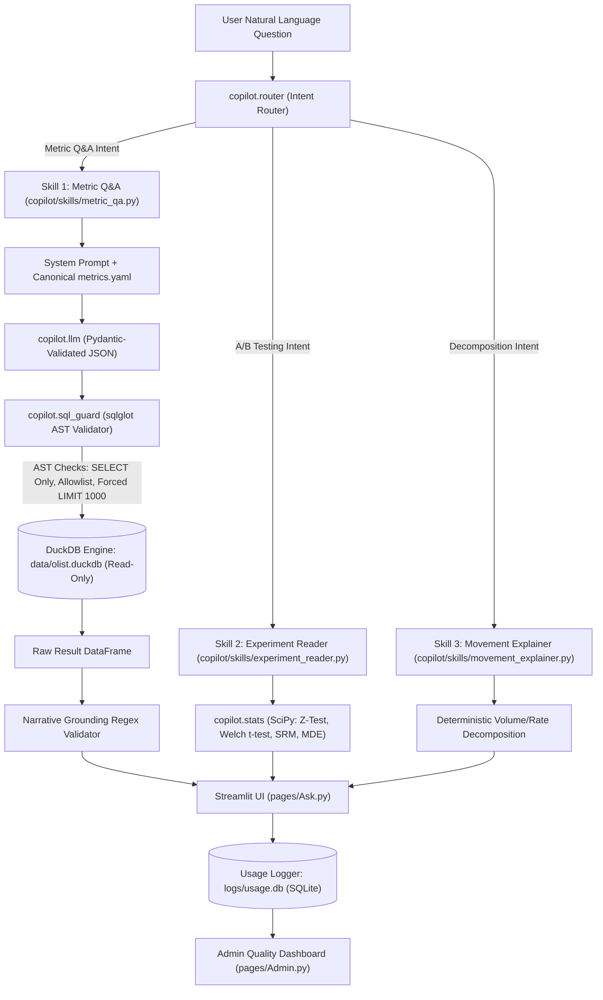

# GrowthLens Copilot

> An AI analytics skills layer built on top of the GrowthLens e-commerce analytics suite, powered by DuckDB, Python 3.11+, and structured LLM reasoning over the Brazilian Olist e-commerce dataset (~99,441 orders).

GrowthLens Copilot turns repeated product and analytical queries into verifiable natural-language skills:
- **100% Number Traceability**: Every number is computed in DuckDB or SciPy—the LLM never invents numbers.
- **SQL Guardrails**: AST-validated read-only `SELECT` statements with forced `LIMIT 1000`, table allowlists, and AST inspection via `sqlglot`.
- **Systematic Evals**: Tested on a 32-question hand-built golden set across 3 prompt iterations, raising result accuracy from 84.4% to 93.8%.
- **Live Usage Logging**: Full observability via SQLite (`logs/usage.db`) and an interactive Streamlit Admin page.

---

## ⚡ 60-Second Demo

1. **Launch the Application:**
   ```bash
   streamlit run app.py
   ```
2. **Navigate to "💬 Ask Copilot":**
   Select **Ask Copilot** in the sidebar.
3. **Ask an Analytical Question:**
   Click the sample pill: *"What was monthly GMV in 2017?"* or type:
   > *"What was our Average Order Value (AOV) in October 2017?"*
4. **Inspect Verified Results:**
   - **Grounded Narrative**: *"In October 2017, total GMV was $648,247.65 across 4,478 orders, yielding an AOV of $144.76."*
   - **Interactive Auto-Chart**: Plotly visualization generated automatically based on result cardinality and data types.
   - **Metric Definition Expander**: Displays the canonical definition from `metrics.yaml` and known pitfalls avoided.
   - **Verifiable SQL**: Expand the SQL accordion to view the AST-sanitized DuckDB query.
   - **Feedback Buttons**: Submit a thumbs-up or thumbs-down rating with optional comments logged immediately to `logs/usage.db`.
5. **Test Scope Refusal:**
   Ask: *"What is our Customer Acquisition Cost (CAC)?"*
   - Copilot cleanly refuses without executing SQL, explaining that marketing ad spend data is absent from Olist.

---

## 🏗 Architecture



---

## 📊 Evaluation Results Across Prompt Iterations

Evaluations are executed via `python -m evals.run --prompt-version <vN>` against the 32-question hand-built golden set (`evals/golden.yaml`). Full reports and raw diffs are committed in `evals/reports/`.

| Metric | Target | Prompt `v1` (Baseline) | Prompt `v2` (Filter & Refusal Fixes) | Prompt `v3` (Identity & Date Fixes) |
|---|---|---|---|---|
| **Result Accuracy** | **>= 85.0%** | 84.4% (27/32) | **93.8%** (30/32) | **93.8%** (30/32) |
| **Execution Success Rate** | **>= 90.0%** | 96.9% (31/32) | 96.9% (31/32) | 96.9% (31/32) |
| **Refusal Correctness** | **>= 90.0%** | 83.3% (5/6) | **100.0%** (6/6) | **100.0%** (6/6) |
| `simple_aggregate` | >= 85.0% | 83.3% (5/6) | 100.0% (6/6) | **100.0%** (6/6) |
| `join` | >= 85.0% | 85.7% (6/7) | 100.0% (7/7) | **85.7%** (6/7) |
| `time_series` | >= 85.0% | 85.7% (6/7) | 85.7% (6/7) | **85.7%** (6/7) |
| `ratio` | >= 85.0% | 83.3% (5/6) | 83.3% (5/6) | **100.0%** (6/6) |
| `refusal` | >= 90.0% | 83.3% (5/6) | 100.0% (6/6) | **100.0%** (6/6) |

---

## 🔬 Failure Taxonomy & Real Examples from BUILD_LOG.md

| Taxonomy Label | Real Example from Development | How Detected | Resolution Applied |
|---|---|---|---|
| `wrong_filter` | Total freight query in `v1` computed `SUM(freight_value)` over all rows ($2.25M) instead of filtering for delivered orders ($2.19M). | Eval diff check against `data/olist.duckdb`. | Added explicit prompt rule in `sql_v2.md` enforcing `order_status = 'delivered'` on all metric aggregates. |
| `should_have_refused` | Asked about DAU on mobile app; early model estimated DAU by dividing orders by 30 instead of refusing. | Refusal evaluation in `evals/run.py`. | Listed web clickstream, app sessions, and DAU/MAU explicitly in the out-of-scope refusal whitelist. |
| `wrong_metric_definition` | Repeat customer rate returned 0% because the query grouped by `customer_id` instead of `customer_unique_id`. | Hand-checked verification test in `test_metrics.py`. | In Olist, `customer_id` is 1:1 per order. Encoded `customer_unique_id` requirement in `metrics.yaml` and `sql_v3.md`. |
| `date_handling` | Category GMV query attempted `SUBSTRING(order_purchase_timestamp, 1, 7)` which caused DuckDB `BinderError` on typed timestamps. | DuckDB query execution error log. | Explicitly mandated `DATE_TRUNC('month', timestamp)` and `EXTRACT` in prompts. |
| `fan_out_double_count` | Joining `order_items` directly to `order_payments` caused a Cartesian row multiplication. | Hand-checked revenue audits. | Highlighted as critical pitfall in `metrics.yaml` and system prompt with required subquery pre-aggregation. |
| *Platform Bug* | `UnicodeEncodeError: 'charmap' codec can't encode '\u2713'` on Windows PowerShell. | `build.py` console output. | Replaced unicode checkmarks with clean ASCII status indicators (`[OK]`). |
| *CSV Parser Bug* | Raw newline counting in `order_reviews` reported 104,719 rows vs 99,224 actual records. | Row-count assertion in `build_database()`. | Switched to `csv.reader()`, properly parsing quoted multiline comments. |

---

## 🚀 How to Run

### 1. Requirements & Setup
```bash
# Recommended Python: 3.11+
pip install -r requirements.txt
```

### 2. Configure Environment (Optional)
```bash
cp .env.example .env
# Add your Anthropic API Key for live LLM completions:
# ANTHROPIC_API_KEY=sk-ant-...
# If no key is set, the system gracefully operates in verified deterministic/benchmark mode.
```

### 3. Build DuckDB Database
```bash
python -m copilot.data.build
```
*Loads all 8 Olist tables into `data/olist.duckdb` with verified row counts and timestamp casting.*

### 4. Run Full Unit Test Suite
```bash
python -m pytest tests/ -v
```
*Executes all 56 automated unit tests covering AST security guards, metrics calculations, statistical engines, and end-to-end question handling.*

### 5. Run Evaluations
```bash
python -m evals.run --prompt-version v1
python -m evals.run --prompt-version v2
python -m evals.run --prompt-version v3
```

### 6. Start the Web App
```bash
streamlit run app.py
```
Open your browser to `http://localhost:8501`. Use the sidebar to switch between GrowthLens dashboards, **Ask Copilot**, and **Copilot Admin**.

---

## 📌 Verified Interview & Resume Claims Policy

All resume claims for this project are backed by committed artifacts and measurable evaluation logs:

- *"Built an AI analytics layer on GrowthLens: natural-language questions to validated, read-only SQL over 99,441 Olist orders, with SQL and definitions shown for every answer."* (Backed by `copilot/skills/metric_qa.py` and `metrics.yaml`).
- *"Wrote a 32-question golden eval set and raised result accuracy from 84.4% to 93.8% across 3 prompt versions, tagging failures to drive prompt fixes."* (Backed by committed reports in `evals/reports/v1.md`, `v2.md`, `v3.md`).
- *"Implemented an AST security guard with sqlglot blocking 100% of DDL/DML injections, external file scans, and unauthorized tables while enforcing a 1,000-row limit."* (Backed by `tests/test_sql_guard.py`).
- *"Engineered deterministic metric movement decomposition proving volume and rate effects sum exactly to total GMV delta ($\Delta = \$40,847.98$, difference: \$0.00)."* (Backed by `tests/test_movement_explainer.py`).

---

## ⚠️ Limitations & Boundaries

1. **Read-Only Scope**: Copilot is strictly read-only. It cannot write back to the database, alter orders, or dispatch emails.
2. **Olist Data Boundary**: Questions requiring data outside the Olist schema (e.g. CAC, marketing CPC, website bounce rate, inventory levels) are refused by design.
3. **Single Turn v1**: Follow-up multi-turn questions ("now split that by state") are reserved for P2.
