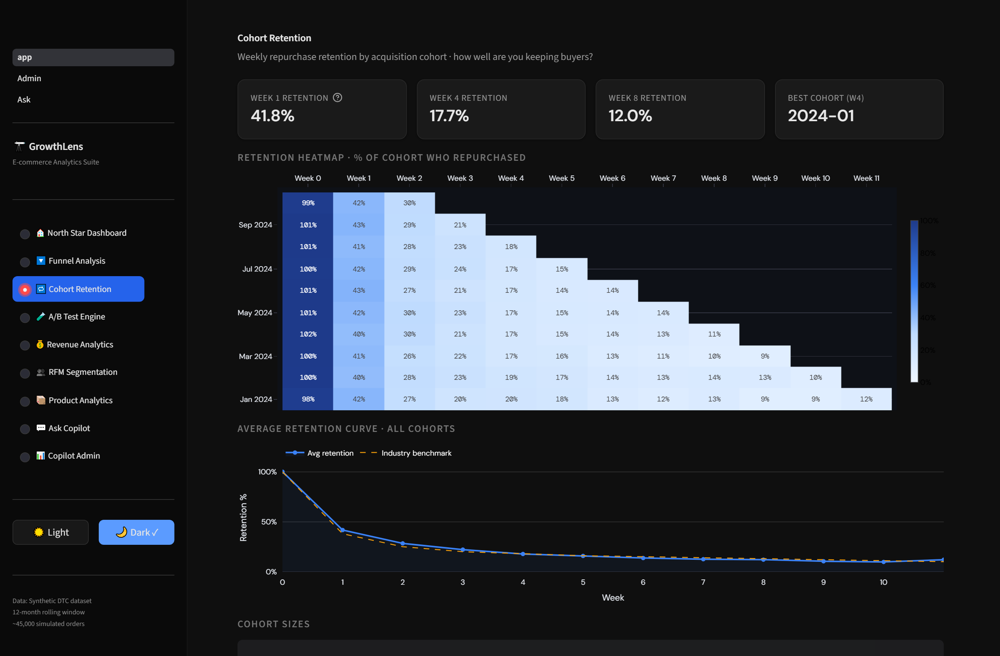
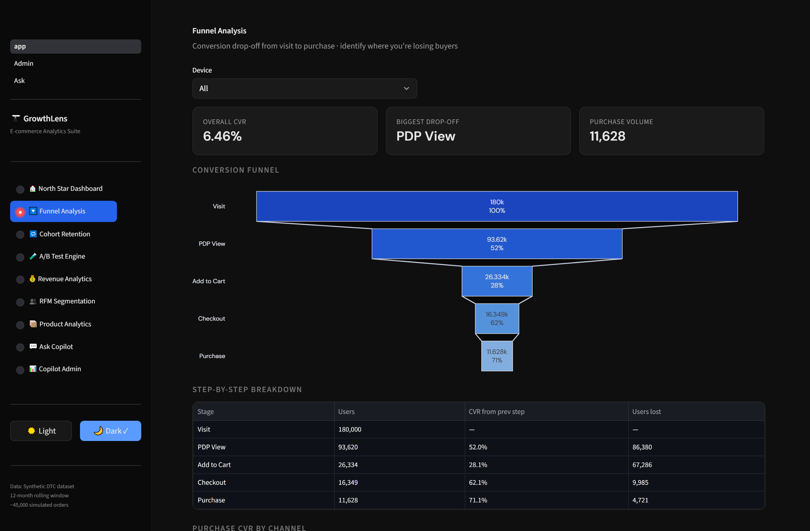
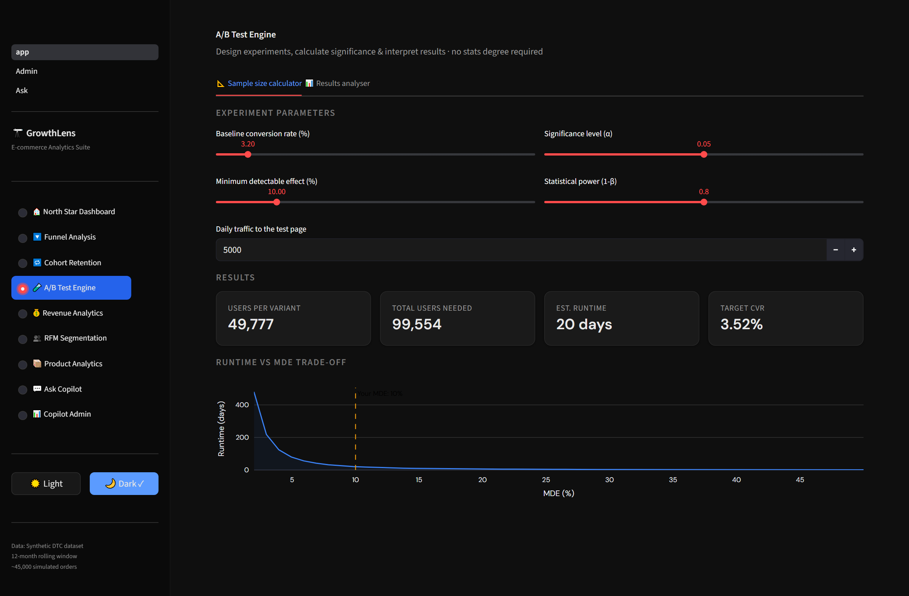
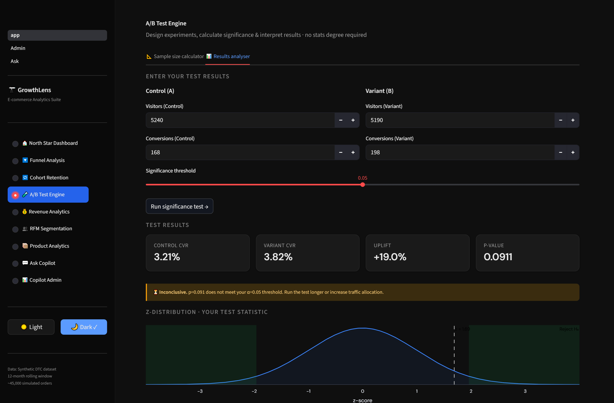

# Case Study: GrowthLens Redesign — Enterprise Data UX

**Role:** Product Designer
**Context:** Personal Project (Redesign of an existing Streamlit app)
**Timeline:** 5 Weeks

---

## 1. Problem
GrowthLens was a functional analytics dashboard built with default Streamlit components. While it successfully handled ~99K rows of data, the UI struggled with information hierarchy, clear handling of statistical uncertainty, and reusable design patterns. The lack of UX maturity made it hard for product managers and analysts to trust and act on the data quickly.

## 2. Users & Goals
Through this redesign, I focused on three primary user archetypes:
1. **Growth Analyst:** Needs to find underperforming cohorts and drill down into funnel drop-offs.
2. **Product Manager:** Needs to interpret A/B test results reliably without being misled by noisy data.
3. **Executive:** Needs quick, high-level health metrics.

**Goal:** Transform the raw data views into a clear, hierarchical, and honest interface, supported by a scalable design system.

## 3. Current-State Audit
A structured heuristic audit of the production Streamlit application revealed critical information architecture and data visualization breakdowns:
- **Flawed Data Integrity Signals:** Floating-point calculation bugs rendered Week 0 cohort retention values at 101% and 102%, instantly compromising credibility with stakeholders.
- **De-contextualized Metrics:** Cohort percentages were decoupled from absolute base cohort sizes (N), hiding statistical weight and forcing analysts into tedious vertical scrolling.
- **Disconnected Transition Metrics:** The funnel graphic displayed bar volumes but concealed drop-off counts directly at transition stages, leaving user drop-off attribution fragmented across the UI.
- **High-Risk Confirmation Bias:** The A/B testing engine presented raw percentage uplifts (e.g., +19.0%) in prominent headline cards without visual confidence intervals, obscuring statistical uncertainty when p-values failed significance thresholds.

## 4. Key Design Decisions

### A. Cohort Module
#### Current State ("Before")

**Design Decisions & Rationale:**
- **In-line Sample Size Column:** Placed cohort base size (N) directly adjacent to cohort monthly labels on the Y-axis so users instantly perceive statistical weight without leaving the heatmap view.
- **Bounded Color Scale & Rounding Guards:** Enforced strict 0–100% normalization with 1-decimal rounding guards to eliminate erroneous >100% artifacts.
- **Multi-dimensional Segmentation Bar:** Added standardized filter chips (Channel, Geography, Customer Segment) above the heatmap to allow root-cause analysis on lagging cohorts.
- **Unified Retention Curve Comparison:** Embedded benchmark curves and historical average lines into a collapsable comparison card directly below the matrix.

---

### B. Funnel Module
#### Current State ("Before")

**Design Decisions & Rationale:**
- **Integrated Transition Bridges:** Redesigned the funnel visualization so drop-off counts (-86,380 users) and stage conversion percentages (52.0%) are visually pinned directly to the connecting bridges between stages.
- **Standardized Top Filter Rail:** Relocated isolated device controls into a persistent filter bar alongside date range selectors, UTM source filters, and conversion window tolerances.
- **Diagnostic Stage Drilldown:** Enabled interactive clicking on high-drop stages (e.g., Visit → PDP) to open a context drawer displaying breakdown by browser, device, and landing page.

---

### C. A/B Testing Module (Designing for Uncertainty)
#### Current State ("Before")
| Sample Size Planning | Results Analyser |
| --- | --- |
|  |  |

**Design Decisions & Rationale:**
- **End-to-End Experiment Lifecycle:** Unified pre-test planning and post-test analysis into a connected workflow where test parameters (MDE, power, target sample) automatically pre-populate the analysis view.
- **Confidence Interval-First Visuals:** Replaced isolated bold uplift numbers with a visual effect-size forest plot showing the 95% confidence interval relative to zero (neutral line), preventing premature celebration of noisy data.
- **Decision-Centric Verdicts with Remaining Runway:** Replaced rigid binary warnings with actionable recommendations ("Run for 6 more days to reach 80% power at current traffic").
- **Intuitive Uncertainty Displays:** Substituted the abstract z-distribution bell curve with a cumulative conversion curve over time accompanied by uncertainty bands.

## 5. Mini Design System
To ensure scalability across all modules, I established a "Data UX" component library in Figma.
- **Color & Typography:** Accessible data palettes (colorblind-safe).
- **Components:** Standardized data tables, chart containers, and filter bars.
- **States:** Defined Loading, Empty, Error, and Low-Sample states.

## 6. Validation (Usability Testing)
I tested the interactive prototype with X users (e.g., 5 students/analysts).
**Key Findings:**
1. ...
2. ...

**Changes Made Based on Feedback:**
- ...
- ...

## 7. Reflection
*What went well, what was challenging, what I would do differently next time.*
